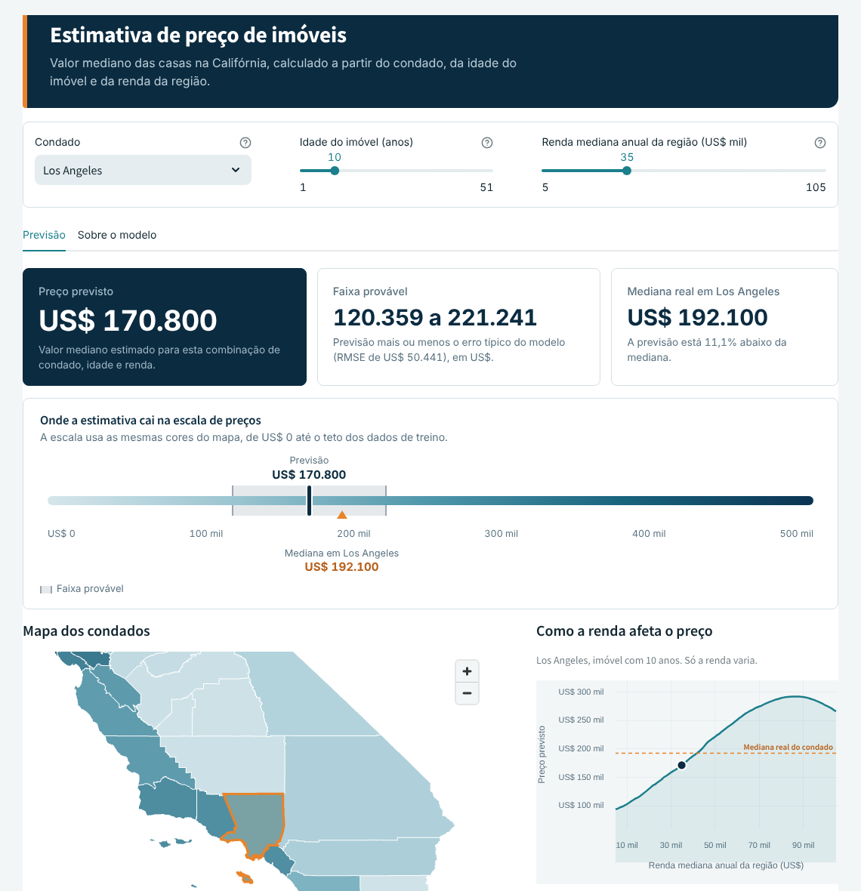
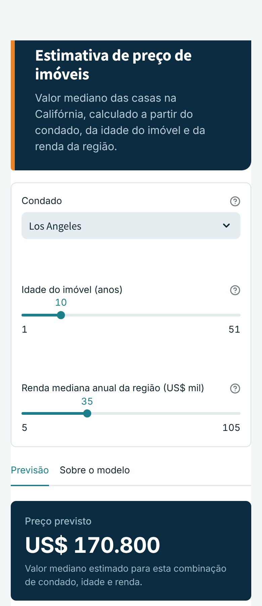
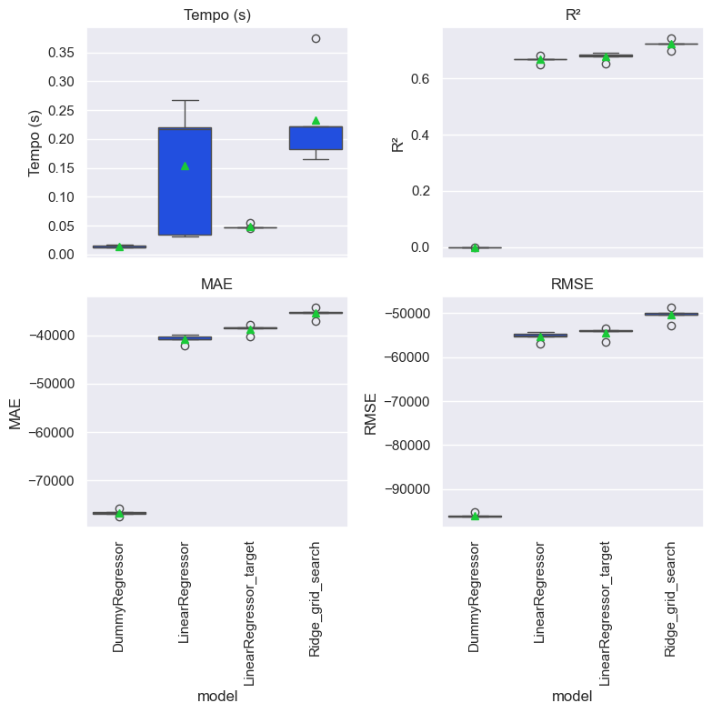
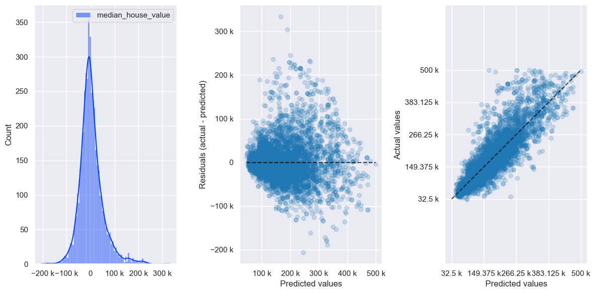
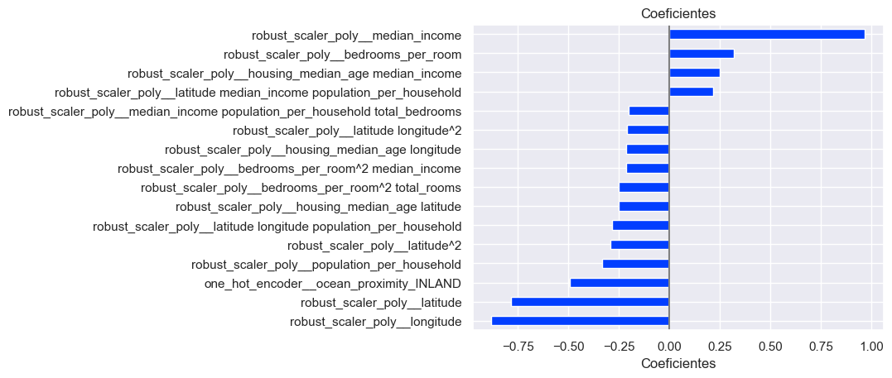
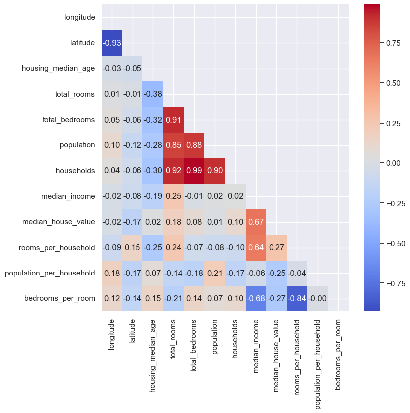
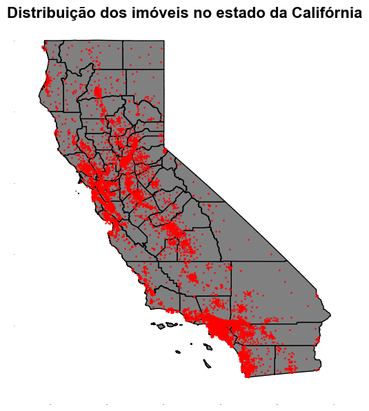

# Previsão de preços de imóveis na Califórnia

[](https://priceprediction-vieirajulio.streamlit.app/)


Modelo de regressão que estima o **valor mediano das casas** de uma região da Califórnia a partir de dados do censo
americano de 1990, publicado em um aplicativo interativo feito com Streamlit.

**Aplicativo online:** <https://priceprediction-vieirajulio.streamlit.app/>

<table>
  <tr>
    <td width="68%"></td>
    <td width="32%"></td>
  </tr>
</table>

## Resumo

| | |
|---|---|
| **Problema** | Estimar `median_house_value` (em dólares) para grupos de blocos censitários da Califórnia |
| **Dados** | 20.640 registros do censo de 1990 (Kaggle); 17.564 após a limpeza |
| **Modelo final** | Regressão Ridge com polinômio de grau 3 e target transformado por `QuantileTransformer` |
| **Desempenho** | R² de 0,72 e erro típico (RMSE) de cerca de US$ 50 mil na validação cruzada de 5 folds |
| **Entrega** | Aplicativo Streamlit com mapa por condado, faixa provável de preço e análise de sensibilidade à renda |

## O que o aplicativo faz

1. O usuário escolhe o **condado**, a **idade do imóvel** e a **renda mediana** da região.
2. As demais características do modelo (cômodos, população, localização, proximidade do oceano) vêm das **medianas do condado**.
3. O app mostra o **preço previsto**, a **faixa provável** (previsão mais ou menos o erro típico do modelo) e a **mediana real** do condado para comparação.
4. Uma escala de preços, um mapa colorido por condado e um gráfico de "renda x preço" ajudam a interpretar o resultado.

## Resultados

Comparação dos modelos na validação cruzada (média de 5 folds, notebook `04-jv-modelos.ipynb`):

| Modelo | R² | MAE (US$) | RMSE (US$) |
|---|---:|---:|---:|
| Baseline (prevê sempre a média) | 0,00 | 76.702 | 95.975 |
| Regressão linear | 0,67 | 40.780 | 55.277 |
| Regressão linear + target quantílico | 0,68 | 38.677 | 54.415 |
| **Ridge grau 3 + target quantílico (final)** | **0,72** | **35.370** | **50.443** |

O modelo final reduz o erro do baseline em cerca de 47% e o da regressão linear simples em cerca de 9%.
O erro típico de US$ 50 mil equivale a perto de 30% da mediana dos preços (US$ 171 mil), então o modelo serve
para estimar a ordem de grandeza de uma região, não o preço de um imóvel específico.



<details>
<summary>Análise de resíduos e coeficientes do modelo final</summary>





Correlações entre as variáveis após a limpeza:



</details>

> **Atenção:** as métricas acima vêm de validação cruzada sobre todos os dados limpos. Ainda não há um conjunto de
> teste separado, então os números podem ser um pouco otimistas (veja os próximos passos).

## Decisões e aprendizados

- **Limpeza dos dados.** Registros acima do quantil 0,99 em dez colunas foram removidos (cerca de 15% da base) e a categoria `ISLAND`, com 2 registros, saiu. O resultado ficou em `dados/housing_clean.parquet`.
- **Variáveis criadas.** `rooms_per_household`, `population_per_household`, `bedrooms_per_room` e `median_income_cat`, uma categoria de renda em 5 faixas (cortes em 1,5, 3, 4,5 e 6).
- **Dados geográficos.** Cada ponto foi associado a um condado com `geopandas.sjoin`. Os 148 pontos que caíram fora dos polígonos (áreas costeiras) foram atribuídos ao condado de centroide mais próximo. As medianas por condado alimentam o app.
- **Escolha do modelo.** O `GridSearchCV` testou 33 combinações (grau do polinômio de 1 a 3 e 11 valores de `alpha`) e escolheu grau 3 com `alpha` = 20. A transformação do target ajudou pouco na regressão linear (R² de 0,67 para 0,68). O maior ganho veio do polinômio com regularização Ridge.
- **Lição sobre consistência.** Uma regra de negócio repetida em dois lugares (a categoria de renda no notebook e no app) saiu diferente nas bordas das faixas, o que alterava a previsão. A correção foi replicar exatamente o `pd.cut` do treino. A solução definitiva é colocar essa regra dentro do pipeline.

## Limitações

- Os preços são de **1990** e não representam o mercado atual.
- O alvo é o **valor mediano de uma região**, não o preço de um imóvel individual.
- O app usa medianas do condado inteiro, enquanto o modelo foi treinado com grupos de blocos (áreas menores).
- O conjunto original limita os valores em cerca de US$ 500 mil, então a previsão perde confiança perto desse teto.
- O polinômio de grau 3 pode se comportar de forma estranha em rendas muito altas.

## Metodologia

1. **Análise exploratória** (`01-jv-eda.ipynb`): distribuições, assimetria, outliers, correlações e criação das variáveis.
2. **Mapas** (`02-jv-mapas.ipynb`) e **dados geográficos** (`03-jv-geo.ipynb`): distribuição espacial dos imóveis e agregação por condado.
3. **Modelagem** (`04-jv-modelos.ipynb`): pré-processamento com `OneHotEncoder`, `OrdinalEncoder` e `RobustScaler` com `PolynomialFeatures`, regressão Ridge, `QuantileTransformer` no target e busca de hiperparâmetros.


Distribuição dos imóveis pelo estado:



## Dados

Origem: [California Housing Prices (Kaggle)](https://www.kaggle.com/datasets/camnugent/california-housing-prices/data).
Os dados vêm do censo dos EUA de 1990, com uma linha por grupo de blocos censitários (de 600 a 3.000 pessoas).
Um domicílio (*household*) é um grupo de pessoas que reside em uma casa. Como cômodos e quartos são dados por
domicílio, essas colunas podem ter valores altos em áreas com poucos domicílios e muitas casas vazias, como
resorts de férias.

| Coluna | Descrição |
|---|---|
| `median_income` | Renda mediana do grupo de blocos (em dezenas de milhares de dólares) |
| `housing_median_age` | Idade mediana das casas |
| `total_rooms`, `total_bedrooms` | Total de cômodos e de quartos |
| `population`, `households` | População e número de domicílios |
| `latitude`, `longitude` | Localização do grupo de blocos |
| `ocean_proximity` | Proximidade do oceano: `<1H OCEAN`, `INLAND`, `NEAR OCEAN`, `NEAR BAY` e `ISLAND` |
| `median_house_value` | **Alvo**: valor mediano das casas (em dólares) |

## Estrutura do projeto

```
├── home.py                  <- Aplicativo Streamlit.
├── .streamlit/config.toml   <- Tema do aplicativo.
├── .devcontainer/           <- Ambiente de desenvolvimento (Codespaces / VS Code).
├── .env.example             <- Modelo de variáveis de ambiente.
├── requirements.txt         <- Dependências do projeto.
├── LICENSE                  <- Licença MIT.
├── README.md
│
├── dados/
│   ├── housing.csv                   <- Dados originais (Kaggle).
│   ├── housing_clean.parquet         <- Dados após limpeza e criação de variáveis.
│   ├── california_counties.geojson   <- Contornos dos condados.
│   └── gdf_counties.parquet          <- Medianas por condado, com geometria.
│
├── modelos/
│   └── ridge_polyfeat_target_quantile.joblib   <- Modelo final treinado.
│
├── notebooks/
│   ├── 01-jv-eda.ipynb
│   ├── 02-jv-mapas.ipynb
│   ├── 03-jv-geo.ipynb
│   ├── 04-jv-modelos.ipynb
│   └── src/
│       ├── config.py      <- Caminhos e configurações do projeto.
│       ├── auxiliares.py  <- Funções auxiliares.
│       ├── graficos.py    <- Gráficos exploratórios e de resultados.
│       └── models.py      <- Funções de construção e validação do modelo.
│
└── docs/img/              <- Imagens usadas neste README.
```

## Como executar

```bash
git clone https://github.com/VieiraJulio/Real-Estate-Price-Prediction-ML.git
cd Real-Estate-Price-Prediction-ML

python -m venv .venv
# Windows: .venv\Scripts\activate    |    Linux/macOS: source .venv/bin/activate

pip install -r requirements.txt
streamlit run home.py
```

Para rodar os notebooks, instale também `jupyter` e `folium` (usado no notebook 03) e abra-os a partir da pasta `notebooks/`:

```bash
pip install jupyter folium
cd notebooks && jupyter lab
```

## Tecnologias

Python, pandas, NumPy, scikit-learn, GeoPandas, Shapely, pydeck, Altair, Streamlit, Matplotlib e Seaborn.
As versões estão em [`requirements.txt`](requirements.txt).

## Próximos passos

- [ ] Separar um conjunto de teste (estratificado por faixa de renda) e reportar as métricas nele.
- [ ] Mover o cálculo das variáveis derivadas para dentro do pipeline, para o app enviar só dados brutos.
- [ ] Comparar com modelos de árvores (`HistGradientBoostingRegressor`, `RandomForest`).
- [ ] Adicionar testes automatizados (`pytest`) para a categoria de renda e o formato da entrada do modelo.
- [ ] Mover `notebooks/src` para `src/` na raiz do projeto.

## Autor

**Julio Vieira**, analista de dados.
[GitHub](https://github.com/VieiraJulio) · [LinkedIn](https://www.linkedin.com/in/juliostefanoramosvieira)

Sugestões e melhorias são bem-vindas, pode abrir uma *issue*.

## Licença

Distribuído sob a licença MIT. Veja o arquivo [`LICENSE`](LICENSE).
